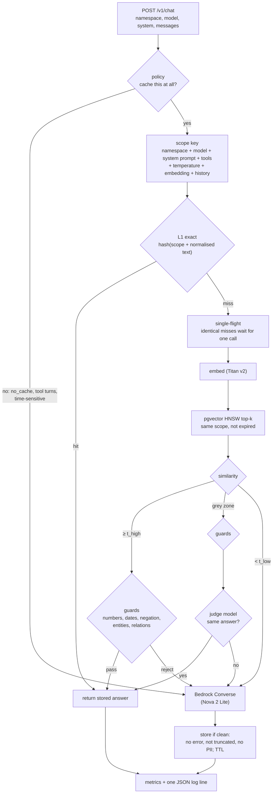
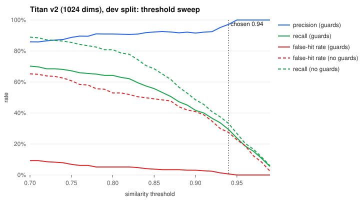

# semantic-cache

[](https://github.com/GouthamTiwari/semantic-cache/actions/workflows/ci.yml)


**An embedding-similarity cache in front of Amazon Bedrock chat calls, tuned to a measured false-hit rate.**

LLM calls take seconds and cost money per token, and users ask the same questions in different words. This cache returns a stored answer when a new question *means the same thing* as one already answered: exact match first, then Titan v2 embeddings in Postgres + pgvector. The hard part is never serving a wrong answer ("refund within 7 days" and "within 30 days" embed almost identically), so the headline metric is the **false-hit rate**: the threshold is tuned on a labelled pair dataset, every match must pass deterministic guards, and savings are reported **after** paying for the embeddings.

## Results

<!-- results:headline -->
- **False-hit rate on the held-out test split: 1.3%** (2 of 153 should-miss pairs; 95 % interval 0.4%-4.6%), at precision 97.4% and recall 62.2%.
- **Same threshold without guards: 25.5% false hits** on the same test pairs.
- **Traffic simulation (5000 requests):** exact match alone saves 83.3% of LLM spend. With the chosen settings (semantic + guards + verifier) the cache saves 86.8% after paying for embeddings and judge calls, with 17 wrong answers (0.3% of requests).
- **Without the verifier** (guards only): 86.2% saved, 1 wrong answer, hit p95 205.5 ms. The verifier buys extra hits but each verified hit waits for a judge call (hit p95 3282.4 ms).
- **Latency (chosen settings):** hit p50 0.1 ms vs miss p50 1457.3 ms.
- Operating point chosen on the dev split only: Titan v2 at 1024 dims, threshold 0.94, all 5 guards, verifier on (grey zone from 0.84).
<!-- /results:headline -->

**How to read this.** On deliberately hard near-miss questions, no similarity threshold alone gets anywhere near the 1 % false-hit target; the guards are what make a safe threshold possible. v1 had four guards and caught relatively few of the reusable paraphrases. Its own simulation showed where its remaining wrong answers came from (relation words: "before" vs "after", "next" vs "last", flipped comparisons), so v2 added a relation guard, re-tuned on dev data that contains those traps, and was tested once on a brand-new test set of topics v1 never saw. The stricter guards also left the grey zone clean enough for the judge model to pay off, which is where most of v2's extra recall comes from. See [v1 → v2](#v1--v2). **Which setting to use:** the published operating point keeps the verifier on, because that was the rule fixed in advance on the dev pairs. The simulation shows its price: a few more points of hits in exchange for more wrong answers and verified hits that wait seconds for the judge. For a latency-sensitive or high-stakes app, run with `CacheConfig(verifier_enabled=False)`; the guards-only row in the simulation table shows what that gives.

Every number in this README is generated from the committed files in [`reports/`](reports/) by `semcache eval`; nothing is typed by hand. Data: 971 labelled question pairs (finance/regulation, customer support, general knowledge) and a 5,000-request traffic simulation. See [Evaluation](#evaluation) for how they were produced and what they do not show.

## How it works



- **Scope isolation (a security property):** an answer is only reused inside the same namespace, model, system prompt, tool set, temperature band, embedding model and conversation history. Tests prove a tenant never receives another tenant's answer at either cache level.
- **Guards:** numbers ("7" = "seven", "2 lakh" = 200000), dates and financial years, negation polarity (including "impossible", "prohibited", "non-..."), swapped named entities (RBI vs SEBI), and relations (before/after, more/less, next/last, maximum/minimum, flipped comparisons) must agree, or the hit is rejected.
- **Grey-zone verifier:** optional judge call for scores just under the threshold; its value is measured, not assumed.
- **Policy:** never caches tool conversations, time-sensitive questions (unless the namespace opts into a 15-minute TTL), errors, refusals, truncated answers, or answers that look like PII.
- **Single-flight:** 50 concurrent identical requests make exactly one LLM call (tested).
- **Streaming:** hits replay as Server-Sent Events; misses stream live and are stored only if the stream finished cleanly.
- **TTL and invalidation:** 7 days / 24 hours / 15 minutes classes, purge job, invalidation by entry, scope or namespace.
- **Fails open:** if embeddings or the database fail, requests still get a live answer.
- **Observability:** Prometheus `/metrics` (decisions, latency histograms, tokens and USD spent/saved/overhead, guard rejections) and one JSON log line per request.

## Quickstart

No AWS account needed for the demo (hashing embedder + mock LLM):

```bash
git clone https://github.com/GouthamTiwari/semantic-cache && cd semantic-cache
uv sync
uv run semcache serve --mock
```

```bash
curl -s -X POST http://127.0.0.1:8000/v1/chat -H "content-type: application/json" -d '{"messages":[{"role":"user","content":"What is KYC?"}]}'
```

Send it twice: the second response has `"decision":"exact_hit"` and a non-zero `saved_usd`.

**With real Bedrock:** copy `.env.example` to `.env`, set `AWS_BEARER_TOKEN_BEDROCK` (a Bedrock API key) and `AWS_REGION`, then `uv run semcache serve`. **With Postgres:** `docker compose up -d` and set `DATABASE_URL` as shown in `.env.example`. **Everything in Docker:** `docker compose --profile app up -d --build`.

**As a library**, in front of any answer function (for example a RAG pipeline, see [`examples/rag_adapter.py`](examples/rag_adapter.py)):

```python
from semcache import ChatRequest, SemanticCache

cache = SemanticCache.from_settings()  # Titan + Nova on Bedrock, pgvector if DATABASE_URL is set
r = cache.get_or_call(ChatRequest(namespace="support", messages=[{"role": "user", "content": "How do I reset my password?"}]))
print(r.decision, r.saved_usd, r.text)
```

## Evaluation

### Dataset
971 question pairs labelled `same` (a cached answer is correct) or `different` (a hit would be wrong), in six categories: paraphrases, and five trap categories (near-miss numbers, negation, entity swaps, same topic but a different question, and relations such as before/after). Each trap category also holds "hard same" pairs that keep the trap on both sides ("7 days" vs "seven days", "before" vs "prior to"), so guards that block good hits are caught too. 30 seed pairs were written by hand; the rest were generated by Nova 2 Lite and reviewed pair by pair (every change is logged in [`docs/DATASET_REVIEW.md`](docs/DATASET_REVIEW.md)).

- **dev** (526 pairs, 28 topics): every setting is chosen here.
- **test** (272 pairs, 16 topics added in v2 and never used before): run once at the frozen operating point.
- **retired** (173 pairs): v1's test split. It was evaluated once, so v2 never uses it again, and the new test split shares no question with it.

### Held-out test result
The operating point was chosen on the dev split only (the lowest threshold whose false-hit rate is at most 1 %, then the grey-zone width with the best recall at the same target), then the test split was run once.

<!-- results:test -->
| config (test split, threshold 0.94) | precision | recall | false-hit rate | false hits |
|---|---|---|---|---|
| with guards (chosen) | 97.4% | 62.2% | 1.3% | 2 |
| without guards | 45.8% | 27.7% | 25.5% | 39 |

By category:

| category | should-miss pairs | false hits | should-hit pairs | recall |
|---|---|---|---|---|
| paraphrase | 0 | 0 | 48 | 62.5% |
| near_miss_number | 31 | 0 | 12 | 75.0% |
| negation | 32 | 0 | 10 | 40.0% |
| entity_swap | 30 | 0 | 16 | 31.2% |
| same_topic_different_question | 32 | 0 | 16 | 75.0% |
| relation | 28 | 2 | 17 | 82.3% |
<!-- /results:test -->

### Threshold sweep and embedding dimension (dev split)

<!-- results:chart -->

<!-- /results:chart -->

<!-- results:dims -->
| dims | config | lowest threshold with dev FHR <= 1% | dev recall | dev FHR |
|---|---|---|---|---|
| 256 | threshold only | none | - | - |
| 256 | threshold + guards | 0.95 | 24.7% | 0.0% |
| 1024 | threshold only | none | - | - |
| 1024 | threshold + guards | 0.94 | 29.4% | 0.7% |

Chosen: **1024 dims**. Rule fixed before the run: choose 256 only if its dev recall at FHR <= 1% is within 2% of 1024's.
<!-- /results:dims -->

### Guard ablation (dev split)

<!-- results:ablation -->
Dev split, 1024 dims, threshold 0.94:

| guards | false hits | removed vs none | false-hit rate | recall | good hits wrongly blocked |
|---|---|---|---|---|---|
| none | 80 | 0 | 27.5% | 33.2% | 0 |
| numbers | 65 | 15 | 22.3% | 32.8% | 1 |
| dates | 78 | 2 | 26.8% | 32.8% | 1 |
| negation | 42 | 38 | 14.4% | 31.9% | 3 |
| entities | 80 | 0 | 27.5% | 32.3% | 2 |
| relation | 56 | 24 | 19.2% | 32.3% | 2 |
| all | 2 | 78 | 0.7% | 29.4% | 9 |
| all (entities strict) | 2 | 78 | 0.7% | 28.5% | 11 |
<!-- /results:ablation -->

### Grey-zone verifier (dev split)

<!-- results:verifier -->
| grey zone from | verifier | recall | false-hit rate | judge calls | judge cost | judge p50 ms |
|---|---|---|---|---|---|---|
| 0.94 | off | 29.4% | 0.7% | 0 | $0.000000 | 0.0 |
| 0.92 | on | 36.6% | 0.7% | 22 | $0.001270 | 761.6 |
| 0.9 | on | 41.7% | 0.7% | 36 | $0.002077 | 2035.4 |
| 0.88 | on | 47.2% | 0.7% | 50 | $0.002880 | 2356.8 |
| 0.86 | on | 53.2% | 0.7% | 64 | $0.003680 | 2332.6 |
| 0.84 | on | 57.5% | 0.7% | 76 | $0.004371 | 2035.4 |

Rule fixed before the run: worth it only if it adds >= 2% dev recall while keeping FHR <= 1%. Result: worth it.
<!-- /results:verifier -->

### Traffic simulation

<!-- results:simulation -->
5000 requests, 240 intents in near-miss families, Zipf popularity, 250 burst copies. LLM mock calibrated from 40 real Nova 2 Lite calls (p50 1371.3 ms); real Titan vectors.

| config | hit rate | exact hits | semantic hits | false hits | LLM calls | total cost | net saving | p50 ms | p95 ms |
|---|---|---|---|---|---|---|---|---|---|
| no cache | 0.0% | 0 | 0 | 0 | 5000 | $1.6983 | 0.0% | 1377.7 | 2377.6 |
| exact only | 83.3% | 4166 | 0 | 0 | 834 | $0.2843 | 83.3% | 0.0 | 1485.2 |
| semantic (threshold only) | 87.0% | 3052 | 1299 | 103 | 649 | $0.2213 | 87.0% | 0.1 | 1534.8 |
| semantic + guards | 86.3% | 3177 | 1139 | 1 | 684 | $0.2335 | 86.2% | 0.1 | 1553.3 |
| semantic + guards + verifier | 90.1% | 2536 | 1969 | 17 | 495 | $0.2244 | 86.8% | 0.2 | 3275.5 |
<!-- /results:simulation -->

Net saving = cost with no cache minus (LLM + embedding + judge cost). A miss in a semantic configuration pays for an embedding and a vector search on top of the LLM call; that overhead is included. Latency is accounted rather than slept: recorded Titan and judge call latencies, measured engine time, and LLM latency sampled from 40 real calls ([`reports/calibration.json`](reports/calibration.json)).

## v1 → v2

<!-- results:versions -->
| version | guards | threshold | dims | test set | test false-hit rate (95 % CI) | test precision | test recall | simulation wrong answers | simulation saving |
|---|---|---|---|---|---|---|---|---|---|
| v1 (tag v1.0.0) | 4 | 0.95 | 256 | 173 pairs, 93 should-miss | 2.1% (0.6%-7.5%) | 90.9% | 25.0% | 48 | 86.2% |
| v2 | 5 | 0.94 | 1024 | 272 pairs, 153 should-miss | 1.3% (0.4%-4.6%) | 97.4% | 62.2% | 17 | 86.8% |
<!-- /results:versions -->

v1 is frozen at tag [`v1.0.0`](https://github.com/GouthamTiwari/semantic-cache/tree/v1.0.0) with its reports in [`reports/v1/`](reports/v1/). What changed and why:
1. **v1's simulation found the failure mode:** almost all of its 48 wrong answers were relation words ("before 55" vs "after 55", "next" vs "last" Friday) and one flipped comparison.
2. **v2 added a relation guard** and two negation cues ("is it false that", opposite-prefix words such as "impossible" and "prohibited", which also caused one of v1's test false hits).
3. **New data:** relation trap pairs were added to dev. The first v2 dev run still showed flipped comparisons phrased in other ways ("Does RTGS take longer than IMPS?" vs the reverse), so the comparison check was rewritten **on dev data** before anything else ran.
4. **A brand-new test set** on 16 unseen topics replaced the retired v1 test split, and was run once.

The v1 and v2 test numbers come from different test sets, so they are not a paired comparison. The simulation is: same 5,000 requests, same seed.

### Reproduce
```bash
uv run semcache eval
```
Regenerates every report and the tables above from the on-disk embedding and verdict memos (free and identical on every run). Building the memos from scratch needs Bedrock: `semcache dataset generate`, `semcache embed-memo --live`, `semcache calibrate --live`, then `semcache eval --live`. The whole project's live spend is capped at USD 5 by a budget file and was about USD 0.15.

## Design decisions and trade-offs

| Decision | Why | Cost |
|---|---|---|
| Threshold from a dev-split sweep | similarity scores on short questions are bunched; intuition fails | needs labelled data |
| Deterministic guards before any judge call | free, explainable, catch the most dangerous near-misses | some good paraphrases are blocked (measured above) |
| Entity guard in "swap" mode | strict mode blocks "repo rate?" vs "RBI repo rate?" | one-sided entity additions pass |
| Verifier optional, decided by a rule fixed in advance | an extra LLM call must prove its value: not worth it in v1, worth it in v2 once the guards cleaned the grey zone | about one judge call per grey-zone lookup; adds 0.7-2 s to those lookups |
| Scope includes system prompt, tools and history | no cross-tenant or cross-prompt leaks | lower hit rate across apps sharing a cache |
| Engine and eval share one decision function | the numbers describe the code that runs | none |
| Fail open | availability beats savings | failures visible only in logs and metrics |
| Single-flight on the exact key | simple and safe | paraphrases in flight at the same moment both pay |
| pgvector, one table per dimension | Postgres is already everywhere; HNSW needs a fixed dimension | one locked connection in v1 (a pool is the next step) |
| Nova 2 Lite as the LLM | the AWS account cannot buy Marketplace models; Claude Haiku is a config change (Converse API) | none for the design |

## What this does not do

- No distributed cache or Redis backend (the `CacheStore` interface allows one later).
- No conversational caching beyond identical history: multi-turn requests only match the exact same earlier turns.
- No coalescing of *different* paraphrases that are in flight at the same moment.
- No fine-tuned embedding model; thresholds are specific to Titan v2 and must be re-swept for another model.
- Guards are lexical rules. The v2 test split's two false hits show what they still miss: an opposite meaning without any guard word ("is 750 *enough*" vs "*too low*") and a flipped comparison hidden by a plural ("better return than fixed deposit*s*" vs "*the fixed deposit* offers a better return"). v1's test also found a unit change without a number ("in minutes" vs "in seconds").
- The test split has 153 should-miss pairs, so one false hit moves the rate by about 0.7 points; the confidence interval is reported next to the rate.
- No real user traffic: the dataset and the traffic are synthetic (generated, then reviewed), English only.
- No authentication beyond an optional admin token, and no web UI.

## Project layout

```
src/semcache/        engine (cache.py), scope, policy, guards, verifier, single-flight,
                     Bedrock clients, stores (memory, pgvector), metrics, API, CLI
src/semcache/eval/   dataset, generators, sweep and ablations, simulation, reports
data/pairs/          labelled pairs, raw generations, review log
data/traffic/        intent families for the simulation
reports/             every number in this README (JSON + Markdown + SVG)
tests/               unit tests (Bedrock mocked), -m db (Postgres), -m live (real Bedrock)
docs/                spec, task list, changelogs
```

## Development

```bash
uv run pytest            # unit tests, free, no Docker
docker compose up -d && uv run pytest -m db   # store contract tests on Postgres + pgvector
uv run pytest -m live    # a few real Bedrock calls (fractions of a cent)
uv run ruff check && uv run ruff format --check
```

## License

MIT © Goutham Tiwari
